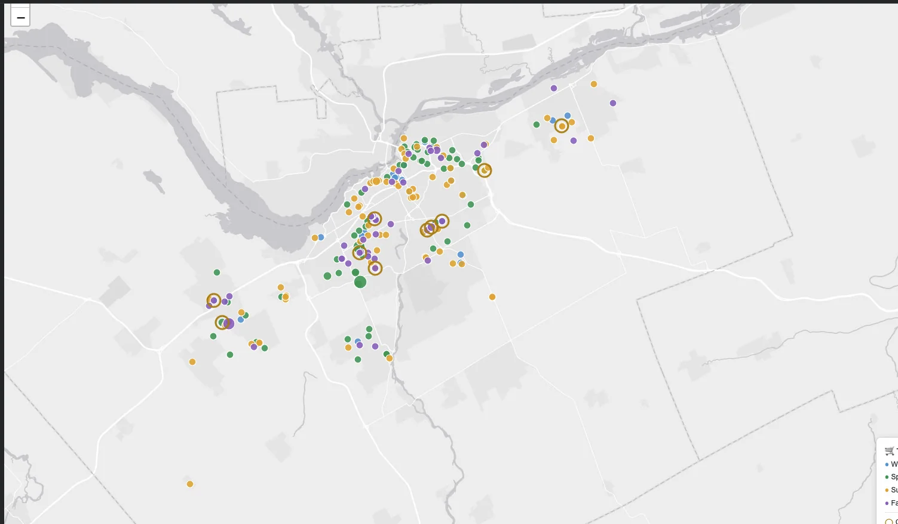

# 🛒 Cartus migratorius
### The Great Ottawa Shopping Cart Migration Study of 2025

**A playful field guide, a serious data-quality investigation, and seven interactive maps.**

[](docs/index.html)

> **411 reports · 247 geocoded · 214 distinct mapped addresses · 164 locations unavailable**  
> *The species is fictional. The calculations and caveats are not.*

**Start with the story:** [Visual field guide](docs/index.html) · [Seven-map atlas](docs/atlas.html) · [Methods](METHODS.md) · [Source credits](SOURCES.md)

> GitHub shows `.html` files as code. To view the actual story, publish the included `docs/` folder with **GitHub Pages**, or open `docs/index.html` locally in a browser.

## Why I made this

Shopping carts appear in remarkable places. I wanted to know what Ottawa's public 2025 311 service-request records could really say about where and when carts were **reported**, where reporting recurred, and how much missing location data changes the answer.

I followed the questions through nine chapters, including data cleaning, a municipal closure-date anomaly, temporal aggregation, recurring address/episode definitions, nearest-neighbour geography, a carefully screened retailer-candidate dataset, and extensive sensitivity analysis. I kept the field-journal humour. I also kept the limitations.

## The story in five findings

1. **The Passport Office.** Summer led all cart-related service requests (**134**), but spring led among geocoded records (**85 vs. 82 for summer**). The mapped population excludes 164 requests, and that missingness varies by service family.
2. **The Returning Residents.** Of 214 mapped addresses, 10 appeared in two seasons; one crossed the seasonal boundary only six days apart. Address recurrence does not establish cart identity.
3. **The Golden Wheel.** A Munster Road location was **11.04 km** from its nearest *other recorded cart address* and **9.69 km** from the nearest core candidate retailer in the later places extract. Neither figure measures a verified cart journey.
4. **The Double Isolation Club.** Nine locations were more than 1 km from both another recorded location and extended retailer candidates under the project's exploratory definitions.
5. **The Woodroffe Effect.** Two sites **225.3 m** apart, with episode starts two days apart, accounted for eight April–May Park reports but only two estimated episodes. Excluding them reduced April–May's annual Park-report share from **61.1% to 50.0%**.

## Visual field guide + real code

The public-facing story is under [`docs/`](docs/), and the seven *actual* interactive Folium maps are under [`docs/maps/`](docs/maps/). They were exported from the final executed Colab notebook, preserving layer controls and legends.

The full analytical record is **not hidden**. [`notebooks/Cartus_Migratorius_Field_Journal.ipynb`](notebooks/Cartus_Migratorius_Field_Journal.ipynb) contains **nine chapters, 71 Python cells, 22 Markdown cells and 17 field observations**. To publish safely, saved execution outputs were cleared. All Python cells are retained from the final edited notebook. A small number of residual plural phrases in Markdown were normalized to a sole-author voice; the fictional field committee remains an explicit storytelling device.

```text
cartus-migratorius/
├── README.md                    # This project overview
├── METHODS.md                   # Decision trail and limitations
├── SOURCES.md                   # Ottawa / Overture / basemap credits
├── analysis/
│   ├── summary.py               # Runnable core CSV / seasonal analysis
│   └── README.md                # Input snapshots and rerun constraints
├── notebooks/
│   └── Cartus_Migratorius_Field_Journal.ipynb
├── tests/                       # Synthetic validation tests
├── data/aggregates/             # Small summary CSVs only
└── docs/
    ├── index.html               # Visual data story (GitHub Pages)
    ├── atlas.html               # Seven-map gallery
    ├── methods.html             # Accessible methods and source notes
    ├── maps/                    # Seven interactive Folium exports
    └── assets/                  # Style, chart interaction, map previews
```

## What I did technically

Python · pandas · NumPy · matplotlib · scikit-learn/DBSCAN · Folium/Leaflet · Haversine distance analysis · categorical and seasonal cross-tabs · source hashing · reproducible validation assertions · alternative retailer scenarios · sensitivity analysis · technical storytelling.

The optional compact script can be executed with an archived input file:

```bash
python -m pip install -r requirements.txt
python analysis/summary.py /path/to/Ottawa_311_2025_Original.csv
python -m pytest -q
```

**Reproducibility boundary:** The full Colab notebook references a separate, privately preserved 2025 Ottawa CSV and 2026 Overture Places GeoJSON snapshot. Neither source archive is bundled here. The original 2025 CSV's SHA-256 fingerprint is recorded in [SOURCES.md](SOURCES.md); the rolling "previous year" feed is not a fixed historical snapshot. The maps are saved exports from the executed notebook. See [analysis/README.md](analysis/README.md) before claiming an end-to-end rerun.

## Publish with GitHub Pages

1. Create a public GitHub repository, e.g. `cartus-migratorius`.
2. Upload **the contents of this folder**, maintaining the nested directories. Do **not** upload the private study guides, raw municipal CSV, private Drive directory or local source GeoJSON.
3. Open repository **Settings → Pages**.
4. Set **Deploy from a branch → main → `/docs`**, then save.
5. After publication, add the displayed Pages URL to your repository's **About → Website** and replace this section with your public story link if desired.

A GitHub Pages site may be public even when a repository has visibility restrictions. Verify there are no private files before making it public.

## Sources and independence

**Contains information licensed under the Open Government Licence – City of Ottawa.** The City of Ottawa's [Open Data Licence v2.0](https://ottawa.ca/en/city-hall/open-transparent-and-accountable-government/open-data/open-data-licence-version-20) permits adaptation and publication subject to attribution. I also used an Overture Maps Foundation 2026 Places archive for exploratory retailer candidate screening; map tiles have separate provider credits. See [SOURCES.md](SOURCES.md) for sources, limitations and licence references.

This is **independent personal research**. It is not affiliated with or endorsed by the City of Ottawa. 311 reports are not tracked individual carts; mapped candidate retailers are not proven cart origins.

---

**CLEAN THE CODE, NOT THE PERSONALITY.** 🛒
